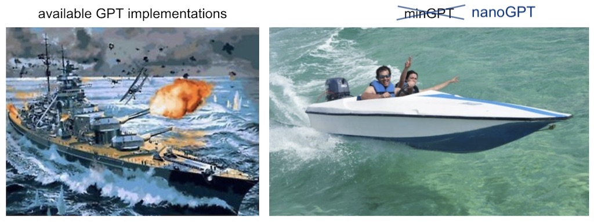
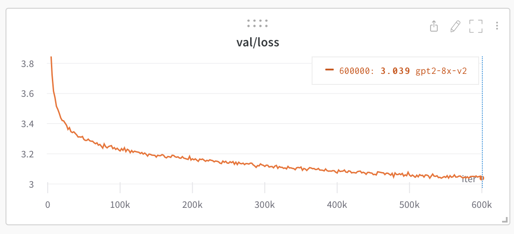

# nanoGPT

<p align="center">
  <a href="README.md">English</a> · <b>简体中文</b>
</p>



---

**2025年11月更新**：nanoGPT 迎来了一个全新且更完善的姊妹项目 [nanochat](https://github.com/karpathy/nanochat)。通常更推荐使用或查阅 nanochat。nanoGPT（本代码库）现已处于早期维护状态并已归档留念，但仍作为经典教学与复现参考完整保留。

---

用于训练/微调中等规模 GPT 的极简、极速开源代码库。它是 [minGPT](https://github.com/karpathy/minGPT) 的重构版本，在保持代码整洁的同时更加注重实战性能（Prioritizes teeth over education）。目前核心文件 `train.py` 能够在单个包含 8 张 A100 40GB GPU 的计算节点上，用约 4 天的训练时间在 OpenWebText 数据集上复现 GPT-2（124M）。代码本身极其简洁易读：`train.py` 是一个约 300 行的基础训练循环，`model.py` 是约 300 行的 GPT 模型核心定义（支持按需直接加载 OpenAI 官方 GPT-2 预训练权重）。核心逻辑仅此而已。



得益于极致精简的代码实现，可以非常轻松地根据自身需求进行修改开发、从零训练新模型，或微调预训练检查点（例如目前可作为微调起点的最大官方模型为 OpenAI 的 GPT-2 1.3B 模型）。

## 安装与环境配置

```sh
pip install torch numpy transformers datasets tiktoken wandb tqdm
```

依赖项列表：

- [pytorch](https://pytorch.org) <3
- [numpy](https://numpy.org/install/) <3
- `transformers`：用于加载 Hugging Face 提供的 GPT-2 官方预训练权重 <3
- `datasets`：用于下载与预处理 OpenWebText 数据集 <3
- `tiktoken`：用于 OpenAI 的极速 BPE 分词实现 <3
- `wandb`：用于可选的实验日志追踪与可视化 <3
- `tqdm`：用于终端训练进度条展示 <3

## 快速上手

如果不具备深厚的深度学习工程背景，只想直观感受大语言模型的生成效果并快速入门，最快的方式是在莎士比亚戏剧文本上训练一个字符级（Character-level）GPT。首先下载单个 1MB 的原始文本文件，并将其转换为连续的整数序列流：

```sh
python data/shakespeare_char/prepare.py
```

执行后会在该数据目录下生成 `train.bin` 和 `val.bin` 文件。接下来即可启动 GPT 训练。模型规模取决于当前系统的计算资源：

**系统配备 GPU**：可以直接使用 [config/train_shakespeare_char.py](config/train_shakespeare_char.py) 配置文件中提供的参数快速训练一个轻量级 GPT：

```sh
python train.py config/train_shakespeare_char.py
```

查看该配置文件可以发现，该模型设定的上下文窗口大小（Context size）为 256 个字符，特征通道数为 384，由包含 6 个注意力头的 6 层 Transformer 构成。在单张 A100 GPU 上，该训练过程仅需约 3 分钟，最佳验证集损失（Validation loss）约为 1.4697。根据配置设定，模型检查点会自动写入 `--out_dir` 目录 `out-shakespeare-char`。训练完成后，可以通过将采样脚本指向该目录从最佳模型中生成文本：

```sh
python sample.py --out_dir=out-shakespeare-char
```

这会生成若干段样例文本，例如：

```
ANGELO:
And cowards it be strawn to my bed,
And thrust the gates of my threats,
Because he that ale away, and hang'd
An one with him.

DUKE VINCENTIO:
I thank your eyes against it.

DUKE VINCENTIO:
Then will answer him to save the malm:
And what have you tyrannous shall do this?

DUKE VINCENTIO:
If you have done evils of all disposition
To end his power, the day of thrust for a common men
That I leave, to fight with over-liking
Hasting in a roseman.
```

哈哈 `¯\_(ツ)_/¯`。对于在单张 GPU 上仅训练 3 分钟的字符级模型而言，生成质量已相当可观。如果在此数据集上微调预训练的 GPT-2 模型，能够获得显著更优的效果（详见后文的微调章节）。

**仅配备 MacBook（或普通轻量电脑）**：无需担心，依然可以训练 GPT，只需适度下调模型超参数规模。建议安装最前沿的 PyTorch Nightly 预览版本（安装时请在[官网配置生成器](https://pytorch.org/get-started/locally/)中选择），该版本通常包含大量底层算子优化。即使使用标准版，轻量级的训练命令如下所示：

```sh
python train.py config/train_shakespeare_char.py --device=cpu --compile=False --eval_iters=20 --log_interval=1 --block_size=64 --batch_size=12 --n_layer=4 --n_head=4 --n_embd=128 --max_iters=2000 --lr_decay_iters=2000 --dropout=0.0
```

由于在 CPU 而非 GPU 上运行，必须显式指定 `--device=cpu` 并通过 `--compile=False` 关闭 PyTorch 2.0 的 JIT 编译功能。同时调整评估频次以实现更快速的估算（`--eval_iters=20`，默认配置为 200），上下文长度减至 64 个字符（原为 256），每轮迭代批次大小降为 12 个样本（原为 64）。此外采用了规模更小的 Transformer 结构（4 层、4 头、128 维嵌入层），并将总迭代步数减少至 2000 步（同时通过 `--lr_decay_iters` 将学习率衰减步数设为约等于最大迭代数）。由于网络极小，亦相应关闭了正则化项（`--dropout=0.0`）。该命令在 CPU 上运行约需 3 分钟，最终验证集损失约为 1.88，生成样本虽有语法瑕疵，但依然很好地还原了戏剧文本的拟真风格：

```sh
python sample.py --out_dir=out-shakespeare-char --device=cpu
```

生成的文本样例如下：

```
GLEORKEN VINGHARD III:
Whell's the couse, the came light gacks,
And the for mought you in Aut fries the not high shee
bot thou the sought bechive in that to doth groan you,
No relving thee post mose the wear
```

对于仅耗费 CPU 3 分钟算力的训练而言，模型已经掌握了字符连贯性的基本形态。如果有充足的等待时间，可以进一步调整超参数、增加网络层数与隐藏层维度、扩增上下文长度（`--block_size`）以及延长训练周期。

此外，在搭载 Apple Silicon 芯片的 Mac 电脑上，配合较新版本的 PyTorch，请务必传入 `--device=mps`（Metal Performance Shaders 简称）；PyTorch 会直接调度板载 GPU 核心进行硬件加速，通常能带来 2-3 倍的训练提速，并支持加载更大规格的网络。详情可参阅 [Issue #28](https://github.com/karpathy/nanoGPT/issues/28)。

## 复现 GPT-2

更侧重学术研究或生产落地的专业开发者可能更关注 GPT-2 基准结果的完整复现。实现流程如下：首先对训练数据集进行分词预处理，此处使用 [OpenWebText](https://openwebtext2.readthedocs.io/en/latest/)（OpenAI 闭源 WebText 数据集的优质开源复现版）：

```sh
python data/openwebtext/prepare.py
```

该脚本会自动下载并处理 [OpenWebText](https://huggingface.co/datasets/openwebtext) 数据集，生成 `train.bin` 和 `val.bin` 二进制文件，按序列存储 GPT-2 BPE 词元 ID（以原生 uint16 字节流格式保存）。随后即可启动正式训练。如需完整复现 GPT-2（124M），建议配备至少包含 8 张 A100 40GB GPU 的计算节点，并运行如下命令：

```sh
torchrun --standalone --nproc_per_node=8 train.py config/train_gpt2.py
```

该过程基于 PyTorch 分布式数据并行（Distributed Data Parallel, DDP）机制持续训练约 4 天，训练损失最终可收敛至约 2.85。官方 GPT-2 原版模型在 OpenWebText 上直接评测的验证集损失约为 3.11，但在该数据集上进行针对性微调后同样会收敛至 ~2.85 区间（主要归因于数据集分布差异），由此可证明两者完全对齐吻合。

若处于多节点集群计算环境，可以通过跨多台 GPU 节点进行大规模分布式训练，以两台计算节点为例：

```sh
# 在首个（主/Master）节点上执行，示例 IP 为 123.456.123.456：
torchrun --nproc_per_node=8 --nnodes=2 --node_rank=0 --master_addr=123.456.123.456 --master_port=1234 train.py
# 在工作（Worker）从节点上执行：
torchrun --nproc_per_node=8 --nnodes=2 --node_rank=1 --master_addr=123.456.123.456 --master_port=1234 train.py
```

在大规模训练前建议使用 iperf3 等网络工具对节点互连带宽进行基准测试。特别注意：若集群未配置专用 InfiniBand 高速网卡，请在上述启动命令前附加环境变量 `NCCL_IB_DISABLE=1`。此时多机分布式训练虽可正常执行，但网络传输吞吐可能成为严重性能瓶颈。默认配置下，检查点会定期保存至 `--out_dir` 目录，训练完毕后只需执行 `python sample.py` 即可进行采样。

若仅在单张 GPU 上进行训练，直接运行 `python train.py` 脚本即可。代码参数设计直观、透明且易于二次扩展，可根据实际硬件环境随时调优。

## 基准对照（Baselines）

OpenAI 发布的官方 GPT-2 预训练检查点为在 OpenWebText 数据集上建立评测基线提供了参照标准。可以通过运行如下命令分别获取各规格的评测指标：

```sh
python train.py config/eval_gpt2.py
python train.py config/eval_gpt2_medium.py
python train.py config/eval_gpt2_large.py
python train.py config/eval_gpt2_xl.py
```

各官方模型在 OpenWebText 上的训练集与验证集损失如下表所示：

| 模型规格 | 参数量 | 训练集损失（Train loss） | 验证集损失（Val loss） |
| :--- | :--- | :--- | :--- |
| **gpt2** | 124M | 3.11 | 3.12 |
| **gpt2-medium** | 350M | 2.85 | 2.84 |
| **gpt2-large** | 774M | 2.66 | 2.67 |
| **gpt2-xl** | 1558M | 2.56 | 2.54 |

需要说明的是，官方 GPT-2 是在 OpenAI 未公开的 WebText 数据集上完成预训练的，而 OpenWebText 是开源社区尽力复现的衍生数据集，两者存在客观的数据集分布差异（Domain Gap）。实验表明，加载官方 GPT-2（124M）检查点并在 OpenWebText 上进行短期微调后，验证损失可迅速收敛至 ~2.85，因此将其作为复现比对的基线更为客观合理。

## 模型微调（Finetuning）

微调的机制与预训练完全一致，核心区别在于初始化时加载预训练权重，并使用较小的学习率进行定向训练。以在全新文本上微调 GPT 为例：进入 `data/shakespeare` 目录并运行 `prepare.py`，使用 GPT-2 的 OpenAI BPE 分词器下载并处理小型莎士比亚文本数据集，生成对应的 `train.bin` 与 `val.bin` 文件。不同于 OpenWebText 的漫长构建，该处理过程数秒内即可完成。微调耗时极短，在单张 GPU 上通常只需数分钟。执行微调的示例命令如下：

```sh
python train.py config/finetune_shakespeare.py
```

该命令会加载 `config/finetune_shakespeare.py` 中的参数覆盖项。本质上，训练流程通过 `init_from` 参数从指定的 GPT-2 检查点初始化模型，并以更低的学习率和更少的步数展开训练。若遇到显存溢出（OOM），可以尝试降低模型基础规格（支持 `{'gpt2', 'gpt2-medium', 'gpt2-large', 'gpt2-xl'}`）或缩小上下文窗口长度 `block_size`。根据配置文件设定，最佳检查点（验证集损失最低的模型）默认会保存在 `out-shakespeare` 目录下。随后可以通过如下命令验证微调效果：

```sh
python sample.py --out_dir=out-shakespeare
```

生成的文本样例如下：

```
THEODORE:
Thou shalt sell me to the highest bidder: if I die,
I sell thee to the first; if I go mad,
I sell thee to the second; if I
lie, I sell thee to the third; if I slay,
I sell thee to the fourth: so buy or sell,
I tell thee again, thou shalt not sell my
possession.

JULIET:
And if thou steal, thou shalt not sell thyself.

THEODORE:
I do not steal; I sell the stolen goods.

THEODORE:
Thou know'st not what thou sell'st; thou, a woman,
Thou art ever a victim, a thing of no worth:
Thou hast no right, no right, but to be sold.
```

微调后的模型风格展现出戏剧对话的张力。配置文件中的超参数并未经过深度网格搜索微调，开发者可根据需求自行探索最优配置。

## 采样与推理（Sampling / Inference）

使用 `sample.py` 脚本既可以从 OpenAI 发布的官方预训练 GPT-2 模型中采样，也可以从自行训练的模型检查点中进行文本生成。例如，从参数量最大的官方 `gpt2-xl` 模型中采样的命令如下：

```sh
python sample.py \
    --init_from=gpt2-xl \
    --start="What is the answer to life, the universe, and everything?" \
    --num_samples=5 --max_new_tokens=100
```

如需对自训模型进行采样，通过 `--out_dir` 指向对应的权重保存目录即可。同时支持从外部文本文件中读取前导提示词（Prompt），例如：`python sample.py --start=FILE:prompt.txt`。

## 性能与效率说明

对于基础的模型基准测试与性能剖析（Profiling），代码库提供了轻量工具 `bench.py`。该脚本精简了训练循环的复杂周边逻辑，聚焦于核心前向与反向传播的算力压测。

代码默认启用 [PyTorch 2.0](https://pytorch.org/get-started/pytorch-2.0/) 运行时环境。通过引入 `torch.compile()` JIT 编译加速，单行代码即可带来显著的吞吐提升（例如单轮迭代耗时从 ~250ms/iter 大幅缩短至 135ms/iter）。

## 待办路线图（TODOs）

- [ ] 探索并引入 FSDP（Fully Sharded Data Parallel）以替代原生 DDP
- [ ] 在通用评估基准上评测模型的零样本困惑度（Zero-shot Perplexities，如 LAMBADA、HELM 等）
- [ ] 优化微调配置脚本超参数
- [ ] 引入训练过程中的线性批次大小（Batch Size）动态增长调度策略
- [ ] 集成现代相对位置编码方案（如 RoPE 旋转位置编码、ALiBi 等）
- [ ] 在保存检查点时将优化器状态缓存与模型权重张量进行独立解耦
- [ ] 增强神经网络训练健康度指标监控（如梯度裁剪事件统计、张量范数分布等）
- [ ] 进一步探索更优的权重初始化策略

## 故障排查与常见问题

代码库默认开启了 PyTorch 2.0 编译优化（即 `torch.compile`）。该特性属于前沿探索性功能，在部分平台（如 Windows 原生环境）上可能存在兼容性限制。若运行过程中抛出相关编译错误，可通过添加 `--compile=False` 标志将其禁用。这虽然会适度降低运算吞吐，但能确保在异构环境下稳定运行。

如需系统了解本代码库的设计哲学、GPT 核心机制以及语言建模基础原理，推荐观看 Karpathy 制作的 [Zero To Hero 系列视频教程](https://karpathy.ai/zero-to-hero.html)。其中深入剖析 Transformer 与 GPT 实现细节的 [GPT 教学视频](https://www.youtube.com/watch?v=kCc8FmEb1nY) 非常适合作为入门导引。

如需更多技术交流与问题探讨，欢迎加入 Discord 社区的 **#nanoGPT** 频道：

[](https://discord.gg/3zy8kqD9Cp)

## 致谢

nanoGPT 项目的全量实验计算资源均由 [Lambda labs](https://lambdalabs.com) 提供的 GPU 云算力驱动。衷心感谢 Lambda labs 对开源社区及 nanoGPT 项目的赞助支持！

---

> **翻译说明（Translation Disclaimer）**
> 本文档由社区志愿者（[@JasonYeYuhe](https://github.com/JasonYeYuhe)）人工翻译并维护，旨在降低中文开发者的阅读门槛。最后同步日期：2026年11月16日。若译文与英文原版存在任何出入或滞后，请以 [英文原版 (README.md)](README.md) 为准。欢迎通过 PR 协助改进译文！
